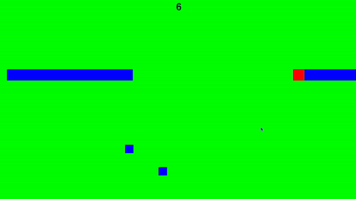
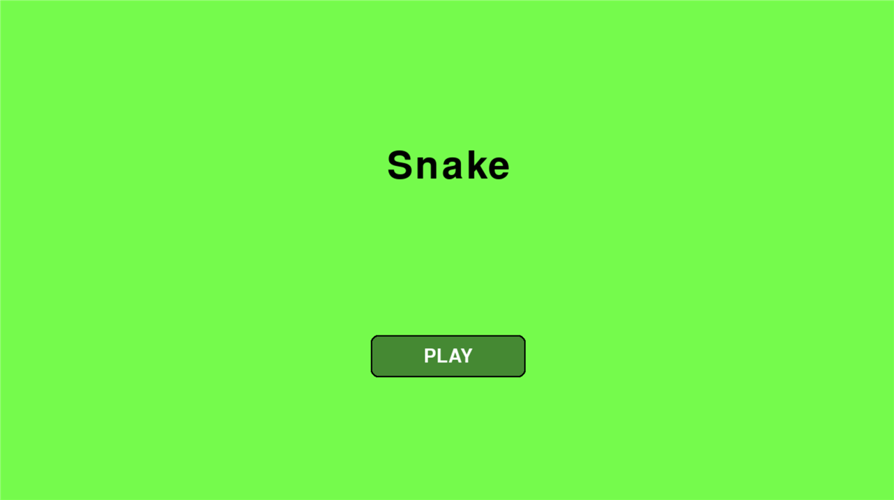
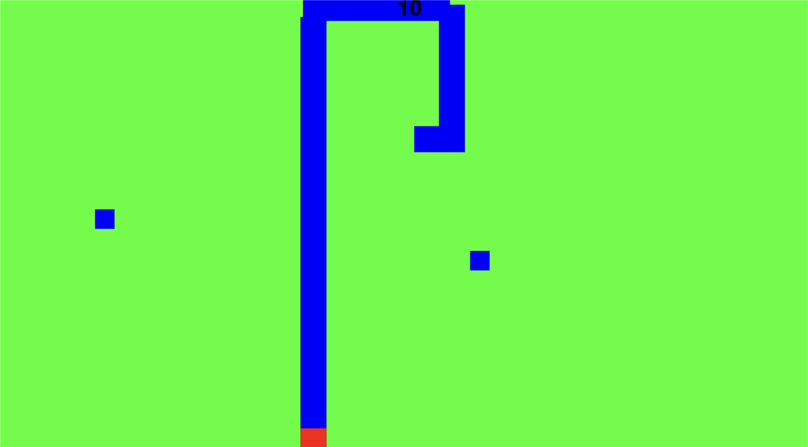
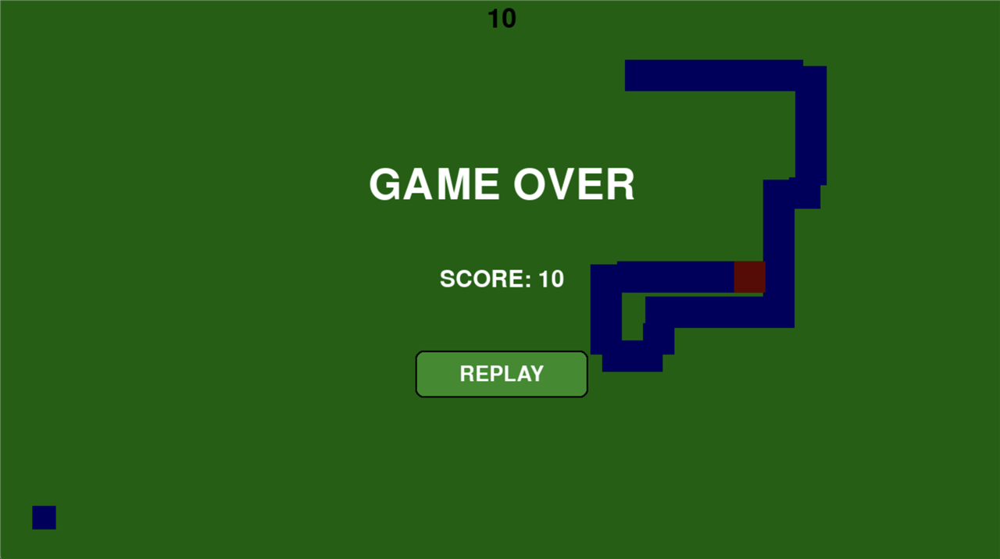

# Snake — Pygame



A Snake game built with **Python** and **Pygame**. I made it during the summer holidays as a personal project to learn Python.

## Features

- Main menu, gameplay and game over screens, managed by a simple state machine
- Smooth movement independent of the frame rate (delta time)
- Tail that follows the head's position history and grows 3 segments per cube
- Cubes spawn every 5 seconds at random positions
- Screen wrap-around: leaving one edge brings the snake back on the opposite side
- Self-collision detection and live score
- Reusable button component with hover effect

## Controls

| Key | Action |
|---|---|
| `W` `A` `S` `D` | Move |
| `Space` or click **PLAY** | Start / replay |

## Screenshots

| Menu | Gameplay | Game over |
|---|---|---|
|  |  |  |

## How to run

Requires **Python 3** (developed with Python 3.12).

**macOS / Linux**

```bash
python3 -m venv venv
source venv/bin/activate
pip install -r requirements.txt
python src/main.py
```

**Windows**

```powershell
py -m venv venv
venv\Scripts\activate
pip install -r requirements.txt
python src\main.py
```

## Project structure

```
src/
├── main.py        # entry point
├── game.py        # game loop and state machine
├── snake.py       # movement, tail and self-collision
├── cube.py        # collectible cubes
├── main_menu.py   # menu screen
├── gameover.py    # game over overlay
└── ui/
    └── button.py  # reusable button
images/            # GIF and screenshots
```

## What I learned

- Organising a Python project into classes and modules
- The game loop pattern (events → update → draw) and delta time
- Pygame basics: surfaces, rects, collisions, events and timers

## Possible improvements

- Save the high score to a file
- Increase the speed as the score goes up
- Unit tests for the snake logic with `pytest`

## Author

**Bruno Paiva** — [GitHub](https://github.com/yesisr) · [LinkedIn](https://www.linkedin.com/in/bruno-paiva-5593a23a8/)
